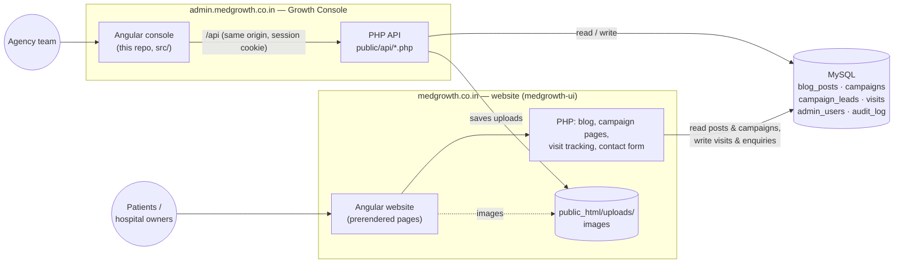
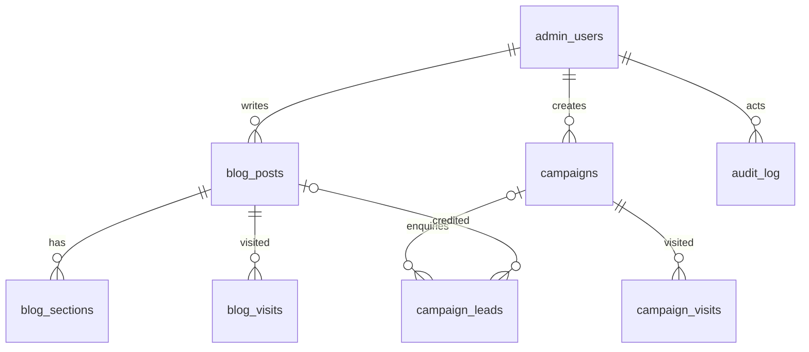

# Growth Console

The admin console for **MedGrowth Digital**, an agency that markets hospitals
and clinics. The team uses it to write blog posts, run ad campaigns with their
own landing pages, and follow up every enquiry the website brings in. It's
built to be sold to other agencies later: modules switch on per client.

- **Frontend:** Angular 19 (standalone components, signals, lazy routes)
- **Backend:** plain PHP 8.1+ (no framework) + MySQL / MariaDB
- **Hosting:** Hostinger shared hosting, at `admin.medgrowth.co.in`
- **Companion project:** [`medgrowth-ui`](https://github.com/anirban-deb-cell/medgrowth-ui)
  — the public website at `medgrowth.co.in`, which reads the same database

---

## Contents

1. [Architecture](#architecture)
2. [Features](#features)
3. [Database](#database)
4. [API](#api)
5. [Project structure](#project-structure)
6. [Local setup](#local-setup)
7. [Deploy to Hostinger](#deploy-to-hostinger)
8. [Configuration reference](#configuration-reference)
9. [Security](#security)

---

## Architecture



**How the two projects work together**

| | Growth Console (this repo) | Website (`medgrowth-ui`) |
|---|---|---|
| Who uses it | The agency team (signed in) | The public, search engines, ad clicks |
| Writes | Blog posts, campaigns, enquiry status & notes, images | Visits, enquiries (forms, Call/WhatsApp taps) |
| Reads | Everything, for the console screens | Published posts and launched campaigns only |
| Tables | All | `blog_posts`, `blog_sections`, `campaigns` (read); `campaign_leads`, `campaign_visits`, `blog_visits` (write) |

A post published or a campaign launched in the console is live on the website
immediately — the website renders it from the database, no rebuild.

**Inside the console**

- **Repository pattern:** pages never call HTTP directly. Each module has a
  repository (`BlogRepository`, `CampaignRepository`, `LeadRepository`) with
  two implementations: `Http…` (the PHP API) and `Mock…` (sample data in the
  browser). `src/environments/*.ts → dataSource` picks one, so the whole
  console can be demoed with no backend.
- **Modules:** `core/modules/module-registry.ts` lists every module (sidebar
  entry + route). `core/config/features.ts → FEATURES.modules` decides which
  are on in this build; each client's `modules` list decides which it sees.
- **Client kind:** a client is a `hospital` (campaigns bring patients:
  specialty, branches) or the `agency` itself (campaigns win business:
  service, no branches) — see `core/data/audience.ts`.
- **Auth:** PHP session cookie (HttpOnly, SameSite=Strict); every request
  carries `X-Requested-With: XMLHttpRequest` (CSRF guard); a 401 sends the
  user to sign-in; requests time out after 30 s (uploads 2 min).

---

## Features

**Live in this release:** Blog, Campaigns, Enquiries. Overview, SEO,
Reputation, Global patients and the agency Portfolio are built as demos with
sample data and switched off in `features.ts`.

### Blog — `/blog`
- **All posts:** status tabs (published, scheduled, in review, draft), search,
  SEO score, "ready for Google" checks (schema, video), and per post:
  **visits, enquiries and conversion rate**.
- **Editor** (`/blog/new`, `/blog/:id/edit`): title, URL slug, category,
  excerpt, intro, sub-topics with images and YouTube videos, tags, photos
  (uploaded, metadata stripped), optional Google Ads conversion ID, publish
  date, author.
- **Live SEO panel:** score out of 100 from title length, meta description,
  slug, cover image, sub-topics, word count and tags; Google / social previews;
  JSON-LD preview; healthcare-claims compliance check.
- **Publish pipeline:** content check → save → JSON-LD → metadata → publish.
  A future date schedules the post (goes live on its date, no cron needed).
  "Request indexing" opens Google Search Console with the post link copied.
- **Roles:** editors save drafts and send for review; admins publish,
  schedule and delete.

### Campaigns — `/campaigns`
- **Editor** (`/campaigns/new`, `/campaigns/:id/edit`), six steps:
  goal & channel (Google Search / Performance Max, Meta lead form /
  Click-to-WhatsApp / Reels) → audience (radius, cities or countries,
  languages, ages, keywords) → budget & schedule → ad copy (with live Google /
  Meta previews) → **landing page** → tracking & review.
- **Landing page step:** either the campaign's own page on the website
  (`/campaigns/<slug>`: headline, offer badge, highlights, text, up to 6
  photos, video, button, phone, WhatsApp — with a live preview) or an existing
  page. Landing pages are not in the site menu or sitemap and are `noindex`.
- **Approval flow:** draft → sent for client approval → **admin** approves &
  launches → pause / resume → end. Flagged healthcare wording blocks launch.
  Live campaigns can't be deleted; ended ones can't be edited.
- **List:** live / waiting / paused / drafts, plus **visits, enquiries and
  conversion** per campaign, "View page", "Copy ad link" (landing URL with
  UTM tags), and a one-click compliance rewrite.
- **Performance** (`/campaigns/:id/performance`): visits, unique visitors,
  enquiries, conversion rate, Call/WhatsApp taps; daily charts; breakdown
  **by traffic source** (utm_source / medium / campaign), device and search
  keyword; 7 / 30 / 90 days or since launch.
- Spend and clicks come later, from the Google Ads / Meta Ads APIs.

### Enquiries — `/enquiries`
One inbox for every lead the website brings in:

- **Where from:** campaign landing pages, the Contact Us page, and enquiries
  **credited to a blog post** the person read first — each with its traffic
  source and, when set, the **Google Ads conversion ID**.
- **Pipeline:** new → contacted → qualified → won / lost, with team notes
  shown on the row.
- One-click call / WhatsApp / email, filters (form vs Call/WhatsApp taps,
  where from, search), **CSV download** (spreadsheet-formula safe).
- Admins can delete an enquiry permanently (spam or a data-deletion request).

---

## Database



| Table | Holds |
|---|---|
| `admin_users` | Console users: email, bcrypt password hash, role (admin / editor), lockout state |
| `blog_posts`, `blog_sections` | Posts and their sub-topics (JSON columns for intro, tags, images, paragraphs) |
| `blog_uploads` | Every uploaded image (blog and campaigns) |
| `blog_visits` | Visits to published posts, with tracking tags |
| `campaigns` | Ad setup + landing page per campaign |
| `campaign_visits` | Visits to campaign landing pages, with all five UTM tags, click ID, device |
| `campaign_leads` | Every enquiry: campaign forms & taps, Contact Us form; status, notes, source, blog post, conversion ID |
| `audit_log` | Who did what: sign-in, save, publish, status change, delete, upload |

SQL lives in `database/`:

```
blog_schema.sql        admin_users, blog_posts, blog_sections, blog_uploads, blog_visits, audit_log
campaign_schema.sql    campaigns, campaign_leads, campaign_visits   (import after blog_schema.sql)
blog_seed.sql          optional: 2 sample posts
campaign_seed.sql      optional: 2 sample campaigns for medgrowth.co.in
migrations/            001_contact_enquiries.sql, 002_blog_tracking.sql,
                       003_uploads_on_main_site.sql, 004_site_taps.sql — only for databases
                       created before those changes; run each once, in order
```

The schema files use `CREATE TABLE IF NOT EXISTS`, so re-importing them is
safe and only adds missing tables.

---

## API

Plain PHP files under `public/api/`, JSON in and out. All except
`auth/login.php` and `public/*` need a signed-in session.

| Endpoint | Method | Who | Does |
|---|---|---|---|
| `auth/login.php` | POST | anyone | Sign in (locks for 15 min after 5 wrong passwords) |
| `auth/me.php` · `auth/logout.php` | GET · POST | signed in | Current user · sign out |
| `blog/list.php` | GET | signed in | All posts + visit / enquiry counts |
| `blog/get.php?id=` | GET | signed in | One post for the editor |
| `blog/save.php` | POST | signed in | Create / update (publishing needs admin) |
| `blog/delete.php` | POST | admin: any · editor: drafts | Delete a post |
| `blog/upload.php` | POST | signed in | Image upload (JPG/PNG/WebP ≤ 5 MB, re-encoded, max 2400 px) |
| `campaigns/list.php` · `get.php` | GET | signed in | Campaigns + visit / enquiry counts |
| `campaigns/save.php` | POST | signed in | Create / update (refused if changed since the editor opened it) |
| `campaigns/status.php` | POST | **admin** | Launch, pause, resume, end, send back |
| `campaigns/delete.php` | POST | not while live | Delete a campaign (its enquiries are kept) |
| `campaigns/upload.php` | POST | signed in | Landing-page image upload |
| `campaigns/stats.php?id=&days=` | GET | signed in | Visits vs enquiries: totals, daily, by source, device, keyword |
| `leads/list.php` | GET | signed in | Newest 2,000 enquiries |
| `leads/update.php` | POST | signed in | Status and notes |
| `leads/delete.php` | POST | **admin** | Permanently delete an enquiry |
| `public/posts.php` · `post.php` | GET | public | Published posts (CORS for the website's domains) |

Shared code: `lib/bootstrap.php` (config, JSON replies, errors, DB, session,
audit), `lib/input.php` (validation), `lib/upload.php` (image handling),
`lib/blog.php`, `lib/campaigns.php`, `lib/leads.php`.
CLI: `tools/create_admin.php` creates a user or resets a password.

---

## Project structure

```
growth-console/
├── src/
│   ├── environments/          dataSource ('api' | 'mock') and apiBase
│   └── app/
│       ├── app.routes.ts       login + the signed-in shell; one lazy route per module
│       ├── core/
│       │   ├── auth/           sign-in page, AuthService, guard, HTTP interceptor
│       │   ├── config/         features.ts — which modules this build shows
│       │   ├── data/           models.ts, audience.ts, mock-data.ts, stores.ts
│       │   ├── layout/         shell + sidebar
│       │   └── modules/        module registry + route guard
│       ├── features/
│       │   ├── blog/           list, editor, BlogRepository
│       │   ├── campaigns/      list, editor, performance, enquiries inbox, repositories
│       │   └── overview/ seo/ reputation/ global-patients/ portfolio/   (demo modules)
│       └── shared/             charts, icons, formatting, compliance checker
├── public/
│   ├── api/                    the PHP API (copied into the build)
│   ├── uploads/                local uploads only (dev); never part of the build
│   └── .htaccess               HTTPS, SPA routing, noindex, security headers
├── database/                   schema, seed and migration SQL
└── proxy.conf.cjs              dev server: /api and /uploads → local PHP
```

---

## Local setup

**Needs:** Node.js 20+, PHP 8.1+ (with `pdo_mysql`, `gd`, `fileinfo`), MySQL 8 or MariaDB 10.4+.

1. **Install**
   ```bash
   npm install
   ```
2. **Database** — create a database (e.g. `medgrowth`) and import, in order:
   `database/blog_schema.sql`, `database/campaign_schema.sql`, and optionally
   the two seed files.
3. **Local config** — copy `public/api/config.example.php` to
   `public/api/config.local.php` and set:
   ```php
   'env' => 'development',
   'db' => ['host' => '127.0.0.1', 'name' => 'medgrowth', 'user' => 'root', 'pass' => '…', 'port' => 3306],
   'site_url' => 'http://localhost:4300',   // the local website, for "View page" links
   'uploads_url' => '/uploads',
   ```
   `config.local.php` is used instead of `config.php` when it exists, never
   committed and never deployed — so `config.php` can hold the server values.
4. **Admin user**
   ```bash
   php public/api/tools/create_admin.php you@example.com "Your Name" admin
   ```
5. **Run** (two terminals)
   ```bash
   npm run start:php     # PHP API on http://localhost:8090
   ```
   ```bash
   npm start             # console on http://localhost:4400 (proxies /api, /uploads to 8090)
   ```
   Both ports are set in `package.json` (`config.phpPort`, the `start` script).

**Sample-data mode:** set `dataSource: 'mock'` in
`src/environments/environment.development.ts` to run the console with no
PHP or database (data is kept in the browser; clear `gc:v2:` keys in
localStorage to reset).

> Stop dev servers with **Ctrl+C**, not Ctrl+Z — Ctrl+Z only pauses them, so
> they keep the port and stop answering.

---

## Deploy to Hostinger

1. **Subdomain:** hPanel → Websites → add `admin.medgrowth.co.in`, turn on SSL.
   PHP 8.1+ with `pdo_mysql`, `gd`, `fileinfo` (on by default).
2. **Database:** hPanel → Databases → MySQL: create a database and user (the
   website uses the same database). In phpMyAdmin import
   `blog_schema.sql`, then `campaign_schema.sql` (seeds optional).
   An existing database: re-import the schema files, then run any
   `migrations/` not yet run, once, in order.
3. **Build and upload**
   ```bash
   npx ng build
   ```
   Upload the **contents** of `dist/growth-console/browser/` to the
   subdomain folder, including hidden `.htaccess` files (File Manager →
   show hidden files). A zip uploaded and extracted in File Manager keeps them.
4. **Server config** — in File Manager copy `api/config.example.php` to
   `api/config.php` and fill in the database name, user and password,
   `'env' => 'production'`, and the uploads location:
   `'uploads_dir' => '/home/<user>/domains/medgrowth.co.in/public_html/uploads'`
   and `'uploads_url' => 'https://medgrowth.co.in/uploads'`. Images are stored
   in the **website's** folder and served from the main domain; the first
   upload creates the folder and its script-blocking `.htaccess`.
5. **First admin** — over SSH, from the subdomain folder:
   ```bash
   php api/tools/create_admin.php you@medgrowth.co.in "Your Name" admin
   ```
   (No SSH? Generate the password hash locally and insert the row in phpMyAdmin.)
6. Flush the Hostinger CDN cache and sign in at `https://admin.medgrowth.co.in`.

**Redeploying:** upload the new build over the old one. **Never delete**
`api/config.php` on the admin site or `public_html/uploads/` on the website.
The build contains no `uploads/` folder, so uploading it can't replace images.

---

## Configuration reference

`public/api/config.php` (server) / `config.local.php` (your computer):

| Key | Meaning |
|---|---|
| `env` | `production` hides error details; `development` shows them |
| `db.host / name / user / pass / port` | MySQL connection |
| `site_key` | Which website the blog/campaigns belong to (`medgrowth`) |
| `site_url` | The website's address, for post and landing-page links |
| `public_origins` | Websites allowed to call `api/public/*` from the browser |
| `uploads_dir`, `uploads_url` | Where images are stored and served from |
| `upload_max_bytes` | Upload size limit (default 5 MB) |
| `session.name`, `session.idle_timeout` | Sign-in cookie name, idle sign-out (default 4 h) |
| `login.max_attempts`, `login.lock_minutes` | Lockout after wrong passwords |

Console-side settings: `src/app/core/config/features.ts` (modules on/off,
default client), `src/app/core/data/mock-data.ts` (client list — website,
kind, Search Console property), `src/environments/*.ts` (data source, API base).

---

## Security

- Passwords hashed with `password_hash`; sign-in locks after 5 failures; every
  sign-in, save, publish, status change, delete and upload goes to `audit_log`.
- Session cookie is HttpOnly + SameSite=Strict; changes need the
  `X-Requested-With` header; the API never sends CORS headers (same origin only).
- All queries use PDO prepared statements; all input is validated server-side.
- Uploads are decoded and re-encoded with GD (strips EXIF/GPS and anything
  hidden in the file); the uploads folder's `.htaccess` (written by the first upload) stops any
  script running there.
- `config*.php`, `lib/` and `tools/` are blocked from the web; API responses
  are never cached (`no-store`) and the console is `noindex`.
- Production hides error details but names common setup mistakes (wrong
  database login, missing tables) without revealing anything sensitive.
